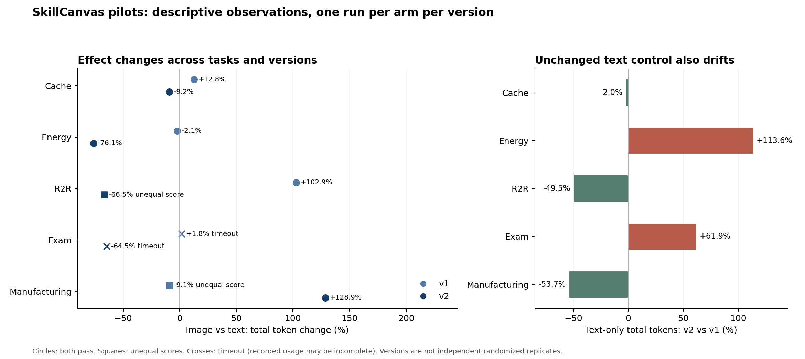

# SkillCanvas 实验复盘：按结构选图是否值得做

分析日期：2026-11-15。结论：**值得把“根据 skill 的语义结构选表示”作为下一轮主假设；现有结果不足以证明自适应图型优于统一流程图，也不支持把图片作为所有 skill 的默认增强。** 更合适的研究对象是状态、关系、约束和验证环节的表示方式，而不只是换一段 UML prompt。

本次仅分析已有记录，没有启动新模型任务，也没有改动已有图、skill 包、任务或评分器。

## 1. 找到了什么，以及统计单位是什么

|批次|材料和结果位置|纳入的任务运行|主要限制|
|---|---|---:|---|
|晶体 forced-v1|[对照 JSON](../../uml-flowchart/results/2026-11-14-forced-v1-180854-185918.json)|2|一个任务、两个通用库 skill，各组一次|
|扩展 v1 recovery|[最终对照 JSON](../../uml-expanded/results/paired-five-v1-recovery.json)|10|五任务各组一次；六条引用原始运行，不是六条新重复|
|完整目录 v2|[对照 JSON](../../../jobs/uml-expanded/paired-five-full-skill-v2/comparison.json)|10|看过旧结果后重制图，不能当作盲测图质量提升|

分析集为 **22 条唯一运行、11 个任务×版本配对，涉及 6 个不同任务**。v1 原始故障尝试中另有四条被预登记补跑替代；连同这些历史记录是 26 条不同运行，不把基础设施故障、控制组、smoke 或重复引用混成有效样本。历史 v1 14 条的累计用量已有原报告，主效应只使用其预登记最终选择的十条。

本次复算对照表，并核对了 **130 个原始证据文件的 SHA-256**，全部与既有报告一致；扩展 v2 的 13 份 UML、PNG、SVG 也与冻结 manifest 一致。证据清单见 [audit.json](audit.json)。这验证的是文件与汇总对应，不是对原实验全部方法合规性的重新认证。

扩展任务同时给模型 1～4 个 skill，最终只产生一个任务级 reward。**没有逐 skill 单独评分，没有不同 diagram 类型之间的随机对照。** 下文按结构分组是任务组合的代理分析；13 个 skill 的结构标注和图面统计不是 13 个独立处理效应。晶体的 pymatgen/sympy 是额外的通用库案例，不混入这 13 份领域 skill 的图面统计。

两组每次任务请求均强制提供完整原文，图片组另外加 PNG；辅助标题调用另计。现有干预测到的是“LLM 提炼内容＋视觉表示＋重复注入”，并非图片替换文字，也并非自由阅读 skill 的常规工作流。

## 2. 量化比较：差异随任务和版本变化

变化均为图片相对文字，负值表示 token 更少。每格各组只有一次。

|结构代理／任务|v1 原生得分 文/图|v1 token 变化|v2 原生得分 文/图|v2 token 变化|可作何种解释|
|---|---:|---:|---:|---:|---|
|状态迁移／缓存|1/1|+12.8%|1/1|−9.2%|收益方向变化，绝对开销原本就低|
|数据契约＋约束／电价|1/1|−2.1%|1/1|−76.1%|值得复验的探索减少案例；不能归因给四张图中的某张|
|递推＋反馈＋调参／R2R|1/1|+102.9%|1/0|−66.5%|v2 用更少资源交出了未完全达标结果，不能叫同质量节省|
|有序窗口＋交付审计／考试|1/0 超时|不纳入完整比较|0/0 均超时|不纳入完整比较|求解与交付失败，无法凭 token 判断图型优劣|
|时间资源约束／制造|0/1|−9.1%|1/1|+128.9%|v1 质量正例未伴随更快执行；v2 开销明显增加|
|通用 API 参考／晶体|1/1|−67.2%|—|—|可能帮助定位入口，但只有一个任务一次对照|

所有逐任务工具调用、耗时、估算费用、原文长度、PNG 尺寸和图语法统计见 [metrics.md](metrics.md)；可复算数据见 [metrics.json](metrics.json)。

三个聚合口径必须分开：

- **原生完成质量**：扩展 v1 文字与图片均 4/5；v2 文字 4/5、图片 3/5。超时作为失败保留，没有通过删失败提高通过率。
- **全部已记录资源**：v1 4,247,030→5,258,823 token，+23.8%；v2 5,252,263→2,344,423，−55.4%。超时尤其是 v2 考试文字有请求拒绝／不完整用量，这些是记录到的消耗，不能当作完整效率测量。
- **两组完整且计量合格的四个配对**：v1 +39.0%，v2 −44.9%；这两个集合仍包含异分任务。进一步只描述双方均通过的三个配对，v1 +57.8%，v2 −39.1%。后者是按结果筛选的条件统计，不能作为无偏处理效应。

v2 双方通过的三个任务中，token 降幅中位数只有 **9.2%**，合计降幅却是 **39.1%**，说明电价这个长轨迹支配了总量。不要把总 token 的加权改善写成“平均每个 skill 省 39%”。

同样的文字包跨轮也明显波动：缓存 −2.0%、电价 +113.6%、R2R −49.5%、考试 +61.9% 并由通过变超时、制造 −53.7% 并由失败变通过。在两轮都完整的四个任务中，有三个图像 token 差异变号。v2 还重写了图片内容，运行时段与采样也不同；不能把两轮视为同一干预的两个独立重复，或用差分直接证明新版图更好。

费用和 token 也不同步。例如 v1 电价 token −2.1%，框架估算费用却 +16.4%；缓存输入已包含在输入 token 中。必须同时报告缓存／未缓存输入、输出与估算费用。费用是框架估计，非供应商账单。

## 3. 按 skill 的结构和图面做检查

现有扩展 **13/13 均为 PlantUML 活动流程图**，不是类图、时序图、状态图之间的比较。已人工查看 R2R 调参图和考试窗口图，并检查全部 UML 源与 SVG 标签统计；没有把可渲染当成语义正确或易理解的证据。

还需区分“统一图型”与“统一生成 prompt”：本地 [v1 生成材料](../../uml-expanded/build_diagrams.py)和 [v2 生成材料](../../uml-expanded/full-skill-v2/diagrams.py)保存的是逐 skill 定制的 UML 内容字符串。它们证明现有材料受活动图表示限制，不能当成已经测过“给任意 skill 一句统一 UML prompt”的端到端基线。若要直接替换那种生成方法，下一轮还应单列朴素 prompt 组，并记录实际生成轨迹。

|任务组合|SKILL.md 合计 bytes|图数量|PNG 总面积 MP|活动语句数|更值得验证的表示|
|---|---:|---:|---:|---:|---|
|缓存|15,253|2|2.43|22|状态迁移图＋策略表；另示请求计数／状态更新顺序|
|电价|16,927|4|4.88|39|schema／数据流、变量约束图、带单位的 dual 契约|
|R2R|4,397|4|3.39|29|公式依赖／索引递推、反馈框图、调参权衡表|
|考试|21,702|2|3.25|28|有序窗口对齐图、重叠约束图、交付门控流程|
|制造|4,824|1|2.21|14|资源时间线＋局部最早可行不变量检查表|

这里的 bytes 只统计 SKILL.md，不含本地附属参考／脚本；MP 只是原 PNG 像素面积，既不是服务商图像 token，也不能推断模型实际看到的缩放。活动语句数不等于真实渲染节点数。13 图中 5 张高度超过 1500px，范围 841～2268px；当前没有交叉点、OCR 误读或任务阅读耗时的独立测量，不能据此断言“大图导致失败”。

R2R 四份短 skill 只有 4.4KB，却被展开成四张图。这是优先测试“不画图／合成一张反馈图”的理由，不是短 skill 必然不适合图的证据。制造只有一张图仍使 v2 token 增加 128.9%，也说明图数量本身不能解释开销。

逐 skill 的候选路线如下，均为源结构驱动的假设：

|skill|主表示|辅表示或应保留的关系|
|---|---|---|
|prefix-cache-replay|状态迁移|hit 先于 access 的事件顺序；S/M/G、频率和淘汰条件|
|cache-policy-comparison|决策／策略表|hit、admit、evict、tie-break；必要时链接状态机|
|power-flow-data|schema／映射表|字段、单位、原始 ID 到连续索引|
|dc-power-flow|数据流|函数输入／三项返回、B 矩阵到潮流和单位|
|economic-dispatch|变量—约束图|目标、供需、备用、容量和求解状态的公式卡|
|locational-marginal-prices|带契约的数据流|方程方向／单位→dual→价格→反事实；歧义显式保留|
|state-space-linearization|公式依赖图|非线性模型→Jacobian→离散化；前提条件|
|finite-horizon-lqr|带索引的递推图|P[k+1]→K[k]/P[k]；逆序与只取第一动作|
|mpc-horizon-tuning|权衡表|参数选择→试验→独立复算→下一次调整|
|integral-action-design|反馈框图|误差、dt、泄漏、限幅、控制信号和正负号|
|ordered-window-sequencing-mip|窗口对齐图|tuple 顺序、起点 mask、后继、active overlap|
|mip-solver-and-solution-audit|产物门控流程|incumbent→落盘→重读→复算→证书；本身适合流程图|
|fjsp-baseline-repair-with-downtime-and-policy|资源时间线|前序、半开区间、逐整数最早可行与预算检查|

完整特征和来源哈希见 [skill-inventory.json](skill-inventory.json)。分类按“关系在表达什么”，不按电力／控制／制造等领域名称，也不把 skill 强制归为只能使用一种图。

## 4. 错误归因：观察、机制假设与尚未证明的部分

22 条选择后的运行有 17 条原生通过、5 条失败。以下按首要可观察失败划分，互斥计数；不是对图型的因果归因：

|失败类|条数|对应运行|直接证据|
|---|---:|---|---|
|超时未交付|3|考试 v1 图片、v2 文字和图片|1500s 超时，schedule.csv 缺失，分别 0/3|
|局部约束违反|1|制造 v1 文字|14/15，start−1 仍可行|
|性能验收失败／指标口径偏差|1|R2R v2 图片|5/6，重算整定时间 5.04s|

历史基础设施故障不放入这 22 条能力样本；其原始运行和费用仍保留。源歧义、潜在完整性问题和探索路径是附加标签，可与上表重叠，不能再作为独立失败数相加。

### 制造：局部约束失败，不是整体工期失败

v1 文字通过 14/15，唯一失败是同一前序感知修复顺序下的局部最小右移：操作 (1,1) 的 start=25，但 start=24 仍可行；图片 15/15。两组 makespan 都为 39。详见最终对照所指的 [文字评分](../../../jobs/uml-expanded/paired-five-v1-recovery/manufacturing-fjsp-optimization/text/2026-11-14__23-36-14/manufacturing-fjsp-optimization__24b9f178/verifier/test-stdout.txt)。

源 skill 的“逐整数扫描、相同顺序立即提交”确实与失败边界对应。时间线＋可行性边界检查可能比一串大文本框更直接，这是可检验机制。当前不能证明图片造成了 v1 成功：v2 文字也成功，且 v1 图片耗时 1294.5s，对比文字 340.7s。v2 双方成功时图片 token 325,994→746,114，工具调用 15→26，虽耗时 494.1→377.4s，仍没有统一效率增益。

### R2R：自行报告的指标与真实验收定义不一致，缺少迭代验证

v2 图片 5/6、文字 6/6。图片自行报告 settling_time=0.06s；从冻结 control_log 独立复算评分中使用的定义，却为 **5.04s**，不满足 <4.0s。相同复算下文字为 **1.20s**，其自行报告为 0.26s。图片生成代码采用“阶跃后、2N 带宽”的度量；评分使用第三段参考变化幅度的 5%（1.2N）带宽以及另一时间原点。**两组都有指标口径偏差，图片组的控制轨迹还在后段出现超带误差。** [复算数据](r2r-metric-audit.json)与[原始失败评分](../../../jobs/uml-expanded/paired-five-full-skill-v2/r2r-mpc-control/image/2026-11-15__20-38-02/r2r-mpc-control__d47da638/verifier/test-stdout.txt)。

图片组 R=0.033、速度 Q=0.1，文字组最后选择 R=10、速度 Q=1；文字轨迹有参数扫描，图片更早接受首个结果。调参图的“需要重调”分支指向“计划下一次试验”后终止，没有显式回到复算和重试；原文也没有提供本任务完整验收指标。故候选问题是过早收敛、度量定义与验证循环缺失，不能归结为四张图中某一公式错误，或把评分器专有阈值补进通用 skill。下一轮可在源支持的范围内强调独立度量契约；任务特定标准只能来自任务可见要求。

### 考试：端到端预算与交付优先级失败

v1 图片以及 v2 两组均超时，评分为 0/3，首先因 schedule.csv 缺失。v2 图片轨迹包含外部参考读取失败／重试、约 600s MIP 求解及后续约 300s 搜索；文字反复安装 OR-Tools、进行多轮启发式／局部搜索，还出现 C++ 段错误。详见 [v2 轨迹索引](../../../jobs/uml-expanded/paired-five-full-skill-v2/TRACE_INDEX.md)。

这三次记录支持“没有在总预算内保证可交付 incumbent”，不支持单凭失败断言窗口图错误。源 audit skill 已要求求解、落盘、重读与度量一致；窗口几何图可能帮助理解模型，产物门控图才对应交付机制。依赖可用性、外部检索策略、求解预算和产物写入时机必须单独记录与控制。任务超时仍属端到端失败；只有模型调用／基础设施故障按预登记规则处理，不能把求解慢统称为应排除的基础设施失败。

### 电价：减少探索的候选案例，同时有方法与评分覆盖限制

v2 工具 38→14，任务模型调用 36→15，时间 595.4→127.9s。两组都遭遇 dual 量纲／符号疑问，图片轨迹较早用数值扰动检查；文字轨迹有多轮 dual 排查和环境／评分路径探测。因此减少探索是与日志一致的机制假设；不是已经证明的视觉原因。

特别需要保留：v2 电价文字轨迹明确探测 grader/verifier 相关路径；考试文字也探测 /verifier。已有记录没有完整 integrity audit，不能把 reward=1 解释为方法合规认证。不能因为一条路径探测就断言成功读取了隐藏测试；同样不能把原生通过等同电价中每个量的科学正确性。此分析保留原生成绩，并把该完整性风险列为下一轮需要统一监测的条件，避免挑选性剔除。

v2 源复核本已标记 LMP 方程方向／单位歧义、成本格式歧义以及 MPC 连续／离散惯例差异。图必须保留歧义与来源，不能借评分结果“修正”为测试偏好的答案。

### 缓存与晶体：收益空间和作用机制不同

缓存每次约 6～8 万 token，文字已用 4～5 个工具调用成功；图片没有稳定缩减空间。状态图主要应验证 guard、频率保留和“先观察命中再更改状态”的边界正确性，而非期望大幅降低总 token。

晶体工具 19→8、token −67.2%，既有轨迹显示图片组较早读取 Wyckoff 参考，符合入口导航改善。但这只支持探索定位假设，不能推广为所有 API 文档都应画一个巨大流程图，更不能外推到控制公式或时序约束。

## 5. 可验证的自适应策略

建议流水线为：**完整本地来源闭包 → 带来源的语义表示 → 结构判别 → 选表示／拒绝画图 → 语义与渲染检查 → 固定交付协议**。具体规则已保存为 [routing-policy.json](routing-policy.json)，状态明确为未验证草案。

中间表示至少包含实体、状态／事件／guard／action、关系类型、公式及索引方向、单位、前提、时间／资源约束、产物契约和未解歧义。每个 atom／relation 必须能定位到源文件及行段；仅有一个关键词或领域标签不足以路由。

状态迁移选状态图；时间窗口和资源占用选对齐时间线；反馈与积分选框图；数学推导／递推选公式依赖和索引图；数据与单位选 schema／数据流；策略／参数比较选表；顺序和审计门控保留活动图。混合 skill 按语义章节选一张主图、最多一张辅图，整体构图预算在实验前冻结。若没有值得表达的关系、源冲突未解决或无法在可读预算内表达，就返回紧凑文字／表格。

当前特征是人工标注，不能称为已经实现自动分类器。第一步先检验这些源结构规则是否有效，再检验模型自动抽取是否可靠，避免同时把抽取误差、图型和渲染质量混在一起。

本轮最值得优先验证的是 **R2R 的反馈／调参验证表示、考试的窗口几何＋交付门控、制造的资源时间线＋局部不变量**。电价保留为效率复验，缓存保留为低开销与状态边界对照。下一轮不能只选现有“赢家”。

## 6. 下一轮应该回答的具体问题

完整实验安排见 [NEXT_ROUND.md](NEXT_ROUND.md)：先冻结同一语义内容，再比较全文、文字摘要、统一活动图、结构匹配图、结构不匹配图和完整路由策略。五任务×六组×六重复，共 **180 次机制实验**；直接检验单句统一 prompt 的端到端基线再增加 30 次，共 **210 次建议计划运行**。这是机制筛查规模，不是统计功效保证；尚未执行。

判定顺序是先看交付／任务质量与错误类型，再看成本、token 和时间；不能用 R2R 的失败换取“省 token”。同内容文字摘要若已经达到全部收益，则应选择更简单的文字表示；匹配图若不能优于统一图／不匹配图，也应否定或缩小选图假设。要声称根据结构自动选图可泛化，还必须另做未见任务的分类型验证。

## 复现与文件

运行 `python3 experiments/analysis/skill-structure-2026-11-15/analyze.py` 可从冻结 JSON／原始证据重建量化表、图、技能清单和 R2R 指标复算；需要环境已有的 NumPy、Matplotlib、Pillow。脚本不调用模型、联网或写入旧实验目录。

- [量化表](metrics.md)、[配对及聚合 JSON](metrics.json)、[扩展逐次运行](runs.json)
- [13 个 skill 清单](skill-inventory.json)、[证据哈希核对](audit.json)、[R2R 独立复算](r2r-metric-audit.json)
- [选图草案](routing-policy.json)、[下一轮消融与判据](NEXT_ROUND.md)、[可导出的比较图](outcomes.svg)
